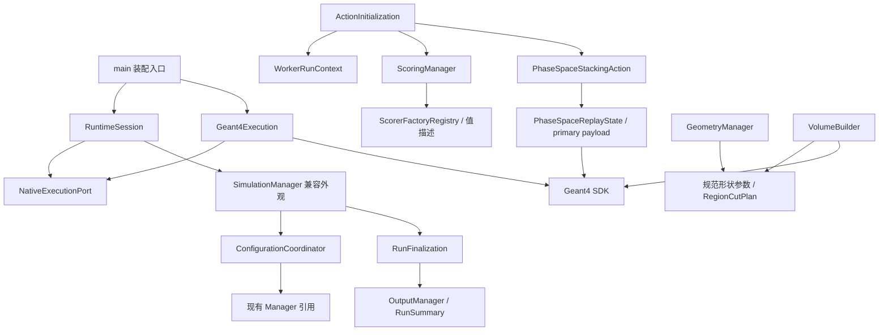

# MR1：AR1–AR3累计成果主审复查

2026-11-09，当前主审对话 `01a1ba89-9372-73d2-8bdb-f253dd9d401f` 在AR1–AR3独立验收后完成累计复查。**结论：MR1通过，可进入AR4。** 收口时发现R1-R-02-B4缺少准确入口，已先补真实run后命令失败正反例并独核；没有用final_flush替代。MR2/MR3仍由当前对话负责。

## 当前候选与复查方式

从K2/AR0冻结25487eb1，沿AR1的776ac64c、AR2的4efaf983、配置协调d3b5e078到AR3 r4工作区累计检查。当前source `afe7518fc93ed2bb7a44b67f2bfea630f6c8d543b2e035c7206d10b0c9944ee6`、tests `dc72245baac3694c0e8e9e5395beb4fd3da16b39dbd6f92c888a269535a781f2`，实际D backend `72a061c99eb19553c23632edc4ee29bb6e03a94810267dfcc68114abe9051481`。HEAD不是工作区内容身份。提交归属清单排除用户原暂存两文件、总体判断和其它历史材料。

主审直接复查当前几何发布点、工厂/worker拥有者、main与SessionServer装配、RunFinalization、SourceManager、PhaseSpaceReplayState、stacking/stepping实际分支；核对原始输入/产物及冻结身份。子审的71份证据/46源码锚点索引仅作导航，没有将其“通过”汇总当作主审判断。主审新生成的比较证据在 `out/collab/20261108-ar0-ar6/mr1-primary-preparation/`；各阶段原始失败与实际验收证据保持原身份。

## 源码依赖与所有权

下图表示源码调用/包含方向，不是业务数据流或已经完成的CMake target图。

几何候选/effective投影先准备，包含可分配Accept操作，再通过不抛出的swap发布；全局读取账本仍可记录拒绝B，不将读取当接受。主审比较当前Geometry目录与AR1签收提交无差异。box/tubs规范参数不是第二份可变几何权威，真实Geant4构造保留为适配层。

ScoringManager/ScorerFactory/HistoryStatistics/EventAction/WorkerRunContext与AR2签收提交无差异；描述不持writer或累计器，sequential借唯一output，MT分别拥有资源。确定性scorer扩展通过登记入口而非main新增类型分支；实际target/include依赖及三类扩展影响仍须AR5/AR6证明。

ConfigurationCoordinator只同步借用现有存储，不承诺配置强事务；RuntimeSession不拥有Manager副本、不自行发布最终摘要。main和SessionServer选择真实执行适配器，一次收尾状态由进程入口拥有；摘要文本与metadata不是跨文件事务。当前Core原生协调仍依赖具体SimulationManager/OutputManager和SDK，这是明确的兼容/原生应用边，不声称已经全平台无关。AR5必须把真实目标边及允许例外落地，不能只按新类名宣布分层完成。

## 有区分力的跨阶段证据

- 几何拒绝B/成功C、用户附加节点及来源账本的原生事务证据，结合当前几何字节不变，覆盖“读取失败但旧模型仍有效”；region粒子cuts与box/tubs真实构造保持原有限范围。
- AR2顺序/worker多run、构造首因和清理一次的原始证据，结合r4真实MT多run CSV与失败摘要读回，区别计分条目数、事件分母和逐run总数。不能用合计相等掩盖单轮缺失。
- r4 batch/csh源命令正反四路实际退出0/1，主审核50产物及输入/摘要，反例零run/事件且后续命令未执行；正常1事件真实primary正确。旧Fatal异常终止没有被“任何非零即通过”掩盖，新候选没有所属残留。
- 相空间连续边界/重放/真实首步分别核实际charge与动态态，固定真空场保持原数值门限。v2场偏差失败与v3修复分开，legacy离子拒绝与正常非离子兼容分开；600 A/B原始数据有独立读回，不靠成功日志猜物理量。
- ROOT与输出故障保留首因、部分/失败不冒成功；B3/B4原11例有限工程、同窗运行所有权和持久证据独验按各自身份引用。r4四夹具以3原通过+单项补测组合，原缺组件失败保留；已清理临时产物的复核边界明确，未捏造原件。

这些组合检查覆盖接受→生成→worker→摘要/结果的主要边界；不作全部可能配置的笛卡尔积保证。AR4的扫描身份、拷贝路径、活动字段与图表消费者尚未实施，按既定阶段继续，而非视为本次漏签后默认通过。

## AR-V与科学证据复用判断

主审将当前十个AR-V文件逐字节对照原冻结：九个完全相同，runner仅CASES注册表变化，其余模块AST以及全部函数/类AST相同；检查器、身份合同、负控与两CI接线均未变。r4实际报告首尾source/tests/程序稳定、无未跟踪源码，strict对原报告执行；独审另核唯一assert标记与原日志SHA。原AR-V首尾观察无法发现中途改后恢复的限制仍在，不能由签收消除。证据为 `ar-v-current-comparison.json`、`cumulative-boundary-comparison.json`，不是仅依靠门禁自证。

主审决定：**保留AR2 H2/H3科学结果的原身份与适用域，本次不追加B/C批次，也不将其改称r4科学运行。** 原18份H3和24份H2输入无phase_space；普通GPS不附payload。当前RestoreBeforeTracking对secondary和无payload立即返回，ObserveFirstStep对无payload不改轨迹，phase捕获分支受原开关限制；无新增随机调用、正常SD/parallel路由、分母、过滤、谱或累计算法变化。主审直接核上述分支及与AR2的实际diff，不仅采用子审结论。

新增stacking入口确实查询共享输出失败锁，可能改变MT时序/worker分配；锁存失败时也会更早停止后续轨迹，不能宣称调度或失败部分输出逐位相同。当前兼容中的MT、多run、取消、输出失败与新相空间受控失败保持失败分类/首因/非成功输出合同；这不外推所有EventProc/MT故障全集，不产生性能结论，F3不追加。若后续改分类/生成/随机数/计分路由或发现无phase量、分母、事件身份偏差，必须按受影响合同冻结新候选复验；科学B/C仍用原协议，不能用单例工程正控替代。

Linux v3与r4的main.cc及seed测试全字节相同，R2-11指定跨平台解析证据可复用；这不是r4完整Linux运行。C三文档模板差异不覆盖用户内容，正式安装/导出须使用真实有效闭包，在AR5/6解决，不假称C完整模板合格。

## 阶段出口

AR3关闭AUD03/09/10/16及R2-11，累计12/27正式问题关闭；R1-R-02-B4有界风险验证完成，其余15正式问题及两项待处置风险继续。AUD02及R2-10必须在AR4完成消费者接线；AR4必须迁移真正无QWidget的数据编辑权威、raw/table草稿与原事务/资格，不只复制已有快照；AR5负责真实依赖目标、SDK/资源/导出/恢复合同；AR6与MR3分别签行为、架构边界和扩展影响。

风险补证已完成：正反两例32/32、事件CSV一致、负宏第3行/code400，负分析准确拒绝failed状态，无成功产物；94文件独核。原收集器actual_threads=1假设失败保留，旧异常收尾unknown不被回填，单独续一次剩余分析不重跑模拟，详情见AR3签收及原独审。未发现剩余未解释候选身份、已完成链数据归属或科学状态矛盾，正式允许进入AR4，保留所有上述边界。当前主审承担结论，MR2在AR4/5独验后、MR3在AR6最终成果上执行，不要求用户逐项确认。
