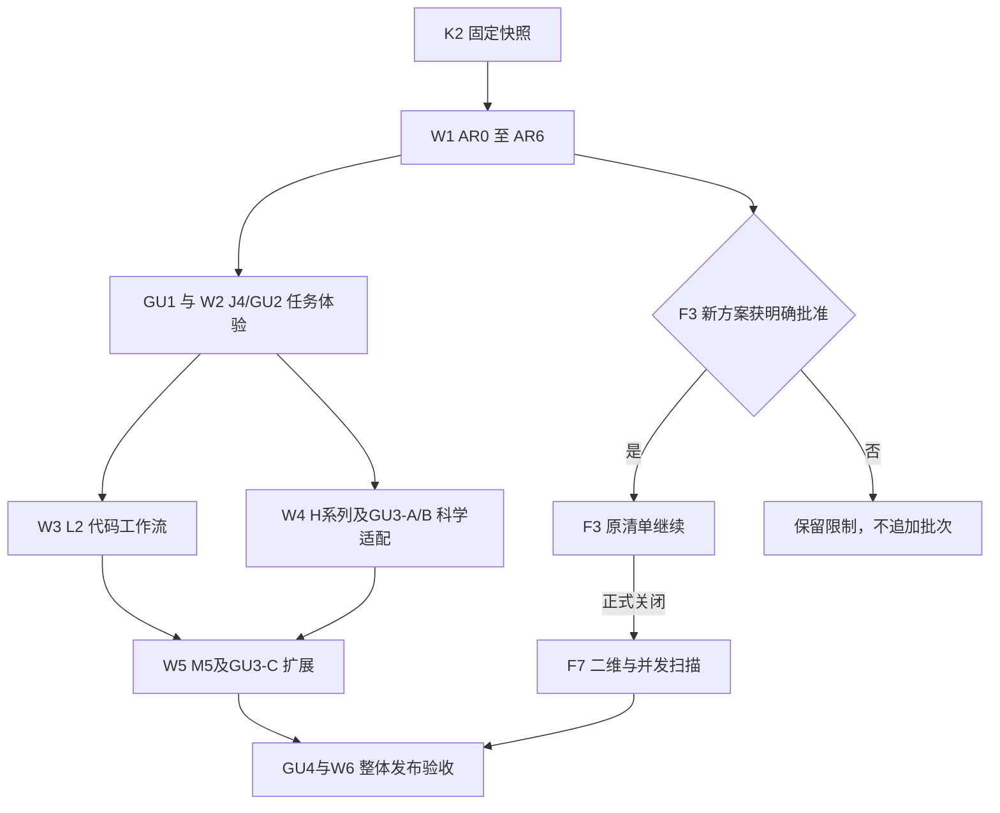

## 2026-11-08 最新授权：AR0–AR6由新主审全权负责

新主审先重审优化AR0，再组织本地非web子代理实现与独立复验AR1–AR6。期间不向DeepSeek新派工、不调用网页模型；整体架构更新完成后恢复两类协作。旧AR2批末暂停及K2停点不再限制本次AR0–AR6授权；F3不追加测量保持。详见[最新决定](collab/decisions/20261108-ar0-ar6-primary-ownership.md)。下方旧决定按日期保留，不作为当前授权。

# G4UniversalSim 后续开发总规划

2026-11-09实施后状态：AR-V、AR1–AR3及[MR1主审累计复查](collab/reviews/20261109-mr1-primary-review.md)已签收。27正式问题关闭19项、余8项；R1-R-02-B4与R2-R01已完成限定防御验证，R2-R02继续。[AR4首片签收](collab/reviews/20261109-ar4-first-slice-acceptance.md)已通过，当前继续SPS/文档域，随后AR5/MR2/AR6/MR3。下文原来源与关闭判据不改。

2026-11-08 架构原则补充已由当前主审采纳，见[阶段落点与例外](collab/decisions/20261108-architecture-principles-adoption.md)：源码依赖方向、装配入口和不可变描述分别落入AR2–5及MR1/MR2；AR6/MR3复用scorer、现有编辑字段、输出/执行替身三例，分别签收行为、架构边界和扩展影响。既有冻结候选保持，不另开功能范围、不因此重跑K2全矩阵。

日期：2026-11-08。版本：接续规划 v1。用途：把 K2 后的架构升级、旧阶段余项、人工意见和最终交付放入同一条接续路线。

**当前架构 AR0–AR6 已获授权并进入实施；新增泛用性/易用性意见已完成有限源码核查与达到方法设计。**阶段状态以 [ROADMAP 当前快照](ROADMAP.md) 为准，正在执行什么以 [CURRENT-SUPERVISION](collab/CURRENT-SUPERVISION.md) 为准；本文件维护依赖、顺序、交付和反馈归属，不另建一套重复进度计数。下方 W0 等最初停点按历史读取。

2026-11-08 补充：[目标泛用性与实际使用体验差距评估](collab/reviews/20261108-generality-usability-gap-review.md)将七类任务、任务级 L0–L4、15/5 分钟和 80% 初始产品目标纳入本路线。新增 GU0–GU4 完成链；J4 增加 J4-5。AR6 技术交付与最终用户目标签收分开，未实测的数据不填“通过”。

同日最新补充：两轮外部联合审计的 **27 项正式问题（P1 8、P2 19）和 3 项待验证风险**逐项归入下文 [审计修复映射](#joint-audit-plan)；当前主线保持 AR0–AR6。新增 [MR1–MR3 主审累计复查](#primary-cumulative-review)，由当前主审对话在实际完成多阶段成果后执行，不以本次计划整理、外部审计或作者自测代替。

## 1. 当前处在什么位置

当前可回退的固定源码快照是 `k2-closed-pre-architecture-20261108`，提交 `25487eb13432c5f4e968aa405607056f6a8febce`。该提交只在 K2 交班基础上补入规划、反馈和记录；产品代码没有开始架构改造。正式工程/测试仍为 `64bacb3e`，产品基线 `b1a7ffbc`，模板 `b2285d11`，不能把文档提交称作新的程序构建。

|类别|当前成果或缺口|后续处理|
|---|---|---|
  |已有可用基础|A1–A7、B/C/D、E1–E7、F1/F2/F4/F5/F6/F8、G1–G6、Q1、2C、I1/I2、J1/J2/J3、K1、L1，以及 H1–H3 的既定交付范围已经有完成记录|作为迁移资产保留，按改动影响回归；不因整体架构升级将旧阶段全部重开|
|带限制的已关闭工作|Q2 科学适用域、J3 原生/显示范围、H3 有限病例和 K2 固定导出子集等|保留原结论与原失败；将需要继续处理的内容放进新的后续任务，不能把“阶段关闭”理解为所有能力普遍验证|
|真正未关闭的阶段|F3：基线资源结果三批均 inconclusive；F3-1 已通过，F3-2 为限制，F3-3/4 未开始|放在架构后效率段接续，保留原清单；恢复测量有独立授权和冻结条件|
|旧计划尚未启动|F7、L2、H4/H5/H6/H8/H7/H9、M5 的完整阶段范围|按第 3、4 节安排，原编号保留，不因为有原型或基础接口就记为完成|
|新架构计划|AR0–AR6 已获授权，阶段执行状态见 ROADMAP|当前实施主线；细节沿用[架构优化规划](架构优化规划.md)|
|人工意见与可用性建议|已有新建流程、导航、几何树、物理列表简介、结果宽表和 Agent 层级等记录|新增 J4 阶段收口；从“泛后续待办”变成有编号、有依赖、有完成标准的任务|
|泛用性与实际体验|已有七类有限源码核查与初始验收方法，无实际用户指标|GU0–GU4 跨阶段追踪，J4-5 负责已有任务体验，GU3 分开导入/科学/扩展缺口|
|整体软件交付|各阶段已有安装/运行证据，不等于后续最终源码的整体发布验收|最后执行 M0–M4 汇总与正式 Windows/Linux 发布验收，等待用户最终确认|

以上是截至本日的范围性归纳，不代表所有旧实验功能、所有平台/版本、所有物理模型均已验证。证据索引以 ROADMAP 逐项链接和 [K2 最终报告](verification/k2-final-20261107/README.md)为准。本轮未重新执行这些测试。不提供一个混合“工程完成、科学验证、可选研究”的总完成百分比。

## 2. 新排期原则与编号

1. **先稳定结构，再改交互，再推进新能力。**AR0–AR6 是第一主线；其中 AR4 解决状态所有权，J4 才改变用户看得到的创建/导航流程，避免把行为变化和内部迁移塞进同一验收。
2. **旧编号保留。**F3、F7、L2、H4–H9、M5 继续使用原编号与任务目的；AR 表示架构迁移，J4 表示工程化模拟流程与可用性，GU0–GU4 表示任务目标及产品验收链。同一实现只有一个责任阶段，GU 引用其证据，不重复计数。下文 W0–W6 只是排期段。
3. **区分依赖与资源顺序。**同一作者、同一文件串行；科学资料准备或独立测试可按实际资源并行。H4→H5 等是默认安排，不意味着光学必须依赖方差降低代码。F7 对 F3、L2 对 K2/L1 则保留实质性前置。
4. **F3 不能拖住无关工作，也不能被绕过。**没有恢复条件时，F3/F7继续保留限制/未开始；可推进 J4、L2 和不依赖其结论的科研任务。它们通过不算 F3 通过，最终全路线完成也不能把 F3 隐去。
5. **已签限制逐项归属，不统一升级为阻塞。**核心正确性问题阻断所影响范围；未观察的额外交互、可选依赖、普通文案或原环境问题不自动阻断所有阶段。
6. **规划排期不等于派工。**用户明确授权实施后，才冻结相应阶段清单、绑定作者与审查候选并开始执行。网页模型暂停、F3 新批次限制、用户数据保护等单独约束不会因进入新段自动解除。
7. **审计修复沿 AR 主线进入，正确性问题不等待交互美化。**下文责任阶段包含有限关联修复切片；每个切片单独冻结候选、正反例和关闭证据，不与结构迁移混成无法归因的大补丁。下一次正式验收先补 R2-05/06/07 的证据工具缺口，保留当前 AR1 作者候选及旧失败身份。

## 3. 总体路线与各段出口

|排期段|主目标与执行顺序|进入条件|本段交班条件|
|---|---|---|---|
|W0 历史准备段|固定 K2 快照、整理架构/旧任务/反馈|已完成 K2 交班|规划输入保留；原暂停已被AR0–AR6授权更新|
|W1 架构升级|AR0→AR1→AR2→AR3→MR1→AR4→AR5→MR2→AR6/MR3；各阶段关联审计修复|已获AR0–AR6授权；既有AR0合同保持；新正式验收前先补AR-V证据工具|27项问题逐项处置并有关闭证据，3风险有有界验证结论；新结构/旧行为/导出与双平台交付通过，原K2快照可回退|
|W2 工程化用户流程|GU1 任务基线→J4-0～4 原流程→J4-5 模板/结果解释/扫描走查→GU2 收口|默认在 AR6 后；AR4 可提前确定状态接口，不提前实施新流程|所有已采纳人工反馈有实际操作证据；常见任务主结果可直接查看，草稿/身份/运行资格保持|
|W3 科研效率与代码工作流|默认先 L2；F3 按条件恢复，只有 F3 正式关闭后进入 F7|L2 依 L1/K2 和架构接口复验；F3 需单独放行限定方案/批次|L2 独立验收；F3/F7分别有自己的通过或明确保留状态，不能打包互相替代|
|W4 高级科研与专项补证|默认 H4→H5→H6→H8→H7→H9；GU3-A/B 真实封装及半导体响应按目标域穿插|对应架构接口稳定、数据/参考/有限范围已冻结；不把前项排队顺序误写成全部代码硬依赖|每个 H/GU3 科学项独立完成真实结果/独立基准；GDML 导入、剂量输运与 SEU 响应分别签收|
|W5 扩展生态|M5 API 兼容与扩展生命周期/管理，GU3-C 实际扩展成本|AR2/AR5 的扩展边界已验；H 项变化后的接口纳入版本说明|非默认 scorer/后处理在声明范围无需修改核心；任意 C++ 动态插件另有设计，不自动包含|
|W6 整体发布|M0–M4 汇总→Windows/Linux 正式包→GU4 非开发者独立使用→文档/限制交班|所有必交项已完成或用户已明确剩余范围；GU 任务/参与者/指标预注册；阻断缺陷关闭|真实包/来源/主流程齐备，真实用户指标单独签收；未达标不得宣称全产品目标完成，等待最终确认|

图中的 J4→高级科研、H序列与 M5 的排队关系表示默认资源顺序。若 F3 未获放行，先继续 L2/独立 H 项；最终汇总仍显式列出 F3/F7 未完成，不能沿另一条图路径宣称全路线关闭。允许在文件所有权不冲突时调整资源顺序；改变科学范围或验收要求须另作明确决定。

## 4. 旧阶段余项逐一安置

### 4.1 F3 / F7：先做可判定的资源评估，再做并发扫描

**位置：W3，AR6 之后；与 L2 分线。**架构改造改变了源码身份，旧 F3 三批仅为历史事实，不能与新程序计时混在同一基线中。旧数据、5% MAD 门、原科学等价与收益判据保持。

恢复入口不是“再跑一批试试”，而是：

1. 核对[原 F3 清单及后续候选方案](collab/decisions/20261107-f3-closeout.md)，列明旧样本/新候选身份、测量噪声尚未解决的事实、拟采用的环境和资源预算。
2. 将只读热点定位、探索性原型与正式端到端比较分开。30–50 次重复、增加事件量、配对/区组等只是候选方法，不是已经批准的默认次数或更改后的验收门。
3. 用户明确批准新的有限方案/批次后，经独审冻结才执行。不得关闭用户其它程序，不循环追加到通过，不把 profiler 样本作为正式计时样本。
4. 恢复 F3-2：可靠基线与一个真实瓶颈；再 F3-3：仅最小优化与科学等价；最后 F3-4：原正式验收。若仍不可判定，保存负结果，继续无关工作。

若热点主要在 Geant4 内部、收益受限，提交占比/上限证据。将 F3 改成“可信性能评估”或取消优化目标是另一个待用户决定的范围变更，**本规划不作此变更，也不解除 F7 原依赖**。

F7 在 F3 与 K1 所需合同就绪后推进：先二维网格与缺失点显示，再线程预算内有限并发，再失败/重试/取消/恢复与逐点身份，最后正式验收。每点独立目录、种子、结果和回执；不得以并发吞吐提升掩盖丢点或重复发布。原单参数串行扫描继续可用。

### 4.2 L2：接在架构稳定的 K2 / L1 上

**位置：W3 的默认主目标，不依赖 F3 或完整 H 系列。**依赖的是 K2 的真实独立工程、L1 的授权动作合同，以及 AR3/AR4/AR5 改造后这些接口仍然成立。

步骤为隔离工程/可审阅差异→构建运行的受控执行→checkpoint与进程身份→有限修复→取消/重启恢复/不重复执行→正式双平台与实际入口验收。第三方编排库是否使用在阶段设计时评估，不预先绑定新框架。

J4-4 先整理现有 L1 Agent 的操作层级，L2 后续增加代码动作时沿用相同状态/授权组件，只补受影响验收，不重新做整套 J4 设计。没有必要等 L2 做完才让人工用户获得更清晰的界面。

### 4.3 H4–H9：保留原编号与独立科研合同

|阶段|默认位置|架构提供的基础与实质前置|必须交付的核心证据|
|---|---|---|---|
|H4 方差降低|W4 首项|AR2 线程/统计边界；已有 Q2 加权/analog 方法与目标域核对|importance/weight windows 约定范围、analog 均值/误差与 FOM 对照；挂接或更快本身不算通过|
|H5 光学|H4 后，独立需求可调整|材料/物理配置与事件计分边界；明确可用参考|光产额、Birks、Cherenkov、表面/光子计数分别验收；不能用一个总量通过覆盖全部机制|
|H6 活化与热中子|H5 后|核数据身份、时间窗、温度/目标材料约束|Bateman 对照、受控热谱及版本/适用范围，缺数据时记录真实阻断|
|H8 规则体素/材料映射|H6 后的默认资源序位；非硬依赖 H4/H5/H6|AR1 几何身份和 AR2 空间计分；原 H8 参考规划；H3 仅在采用独立计分几何方案时成为对应依赖|H8-0 原型/合同→H8-1 完整链路→H8-2 精确/规则/混合模型及有限科学验收；坐标/质量/计分/收敛/资源各自证据|
|H7 局域 DNA/径迹结构|H8 后默认排期|粒子、能区、材料与 region 模型边界；不借接口通用性扩大适用域|官方样例回归与独立参考分开，目标量与模型切换边界验收|
|H9 通用直方图/ntuple|保持 H 序列最后|F1 输出契约与 AR2/AR5 边界|版本兼容、原始记录独立复算、线程/多 run 写出和错误路径；不批量删除旧 writer|

H8 自适应 H8-R、DICOM、真实 SiP 数据接入等可选范围保留在原[H8 参考规划](ROADMAP.md#h8-reference-plan)，不作为基础规则体素交付的无限前置。本轮保留该段用户原稿，不改其中技术约定。H8 资源测量也必须有自身冻结协议，不冒充解除 F3 噪声限制。

### 4.4 Q2 已签限制：以专项补证接续，原 Q2 不重开

|原限制|安排位置|进入条件和完成口径|
|---|---|---|
|带电 XS 偏置 factor10 原失败、factor1.2 受限通过|W4 的 H4 目标域核对时优先评估，单列“既有 XS 偏置补证”任务|H4 新算法与旧 XS 不是同一实现。若目标研究需要原失败域，必须先解决该域正确性并独立复验；无关目标不自动受其阻断。原失败不可改写|
|完整强子混合 LET|W4 计分研究支线，在需求涉及该谱时启动|有独立参考/可信量定义后冻结比较；不能从 EM-only 结果外推，不以新增 H 功能替代补证|
|DDD 完整逐步观测不足|W4 与半导体/H8 科研案例准备衔接，独立任务|先具备实际计分步/事件全集和所需动能信息；普通 hits 不能替代；未经允许不为观察无限扩张生产输出|
|NIEL 表物理有效性未对齐|W4 半导体研究前的资料/数据支线|核对可合法使用的参考数据、模型、粒子/能区/单位；与 DDD 算术和结构验证分别验收|

这些支线的研究成本、输入数据和接受标准尚未冻结。无独立参考时可以整理缺口和保留限制，但不能称物理验证通过。当前阶段的核心目标若依赖某个未证实量，该范围必须保持未完成；与其无关的工程或科研任务继续推进。

### 4.5 M5 与 M0–M4 汇总

M5 放 W5，复用已有可信 Python 后处理扩展和 AR2 编译时注册基础，完成约定的 API 版本兼容、第三方扩展生命周期与管理。AR2 的测试 scorer 只证明构造接口，**不等于 M5 完成**；Agent provider 也不是完整插件系统。C++ 动态扩展/隔离需要单独设计与授权，不直接塞入架构阶段。

M0–M4 是 W6 的汇总视角，不重复建设新产品：M0 审查真实性/契约覆盖，M1 汇总已声明后端能力及拒绝边界，M2 汇总科研证据和适用域，M3 验证 GUI 端到端主流程与人工反馈，M4 验证测试/构建/安装/分发身份。未做汇总审查前，不从某一个子阶段通过推导这些里程碑整体通过。

## 5. 新增 J4：工程化模拟流程与可用性

J4 是新的功能/交互阶段，当前未开始。它承接人工意见和已经筛选的建议，不重开 J1/J2/J3/F8，不扩大 K2。默认 AR6 后实施；AR4 仅预留单一项目状态、事务和导航绑定接口。

### 5.1 J4 子项和可判定完成标准

|子项|范围|完成标准|依赖/注意点|
|---|---|---|---|
|J4-0 设计与当前行为核查|核对已有新建/打开/向导/导航入口，明确空工作区、已建立模拟、运行中、结果历史状态；确定窗口方案|有限交互图、控件/动作状态表、原行为映射和验收输入冻结；历史截图/按钮数量不冒充当前实测|不另建通用原生验收平台；阶段此时才冻结详细清单|
|J4-1 新建模拟窗口与入口|“新建→配置→运行”流程；左上角明显的新建入口，与原菜单/快捷键共用动作|无当前模拟时有明确引导；新建成功才进入该模拟配置；打开旧项目也能建立上下文；取消/失败不损坏当前数据，运行仍须校验|不默认多主窗口；空白/模板/导入复用既有功能，未保存修改与运行忙状态受保护|
|J4-2 导航和几何层级|左侧配置父项下直接列源/几何/材料/物理列表/3D等；3D选择即显示对应视图；体积父子树|导航选中与内容/项目一致；深层树能展开定位；树与真实几何父子身份一致；切换不丢草稿，不误改运行资格|树先做显示与定位；拖放改父节点、多文档同时运行等不由本反馈自动引入|
|J4-3 说明与结果浏览|物理列表悬停简介、结果宽表横向发现性/可用空间、有关普通文案|所有实际可选列表说明与支持版本/用途一致；右侧列可发现且可达，文件树/表格分栏在切页/重启后的行为明确；结果身份不变|固定首列、折叠文件树或记忆比例为可选实现，J4-0择优冻结，不全部叠加|
|J4-4 Agent操作层级与跨页验收|当前主要动作突出，取消/授权/拒绝仍可发现；长名称/路径/DPI、主题/语言及状态一致|现有L1各状态主动作清楚；不通过隐藏授权或取消来减按钮；Windows代表性125%/150%和既有独立Linux桌面通道验证受影响流程|L2后续沿用并补验；不声称WSLg限制已自动解决，不重复穷举旧主题矩阵|
|J4-5 任务模板与结果解释|按 GU1 差距复用/补齐辐照与多层任务入口、敏感区选择、Dose/场景结果和现有扫描入口；显示模型假设、单位/分母/统计/限制|T01/T02/T04/T06 主结果无需用户写解析器；20能量点一次定义且逐点身份/失败可见；关闭AI仍可完成；GU2工程走查通过并准备GU4真实测试|不另造平行任务引擎，不把任意CAD/SEU/角度并发塞入J4；15/5分钟和80%须真实用户验收|

J4 的必要端到端案例为：空工作区→新建→编辑非法草稿→修正→配置校验→运行→结果查看→保存/重开；另覆盖打开旧项目、取消新建、未保存切换、运行中受限操作、错误/取消后的状态。实际模拟、界面操作与合成状态测试分别记录，不能用截图或 exit0 代替结果验证。

### 5.2 每条意见和建议的唯一归属

|来源项|编排位置|采纳程度与边界|
|---|---|---|
|2026-11-08：新建模拟作为窗口，先新建再配置/运行|J4-0 定窗口形态，J4-1 实施|采纳目标；先复用既有向导/项目动作，不默认新增多窗口并发|
|2026-11-08：左上角另一“新建”入口|J4-1|采纳；与所有原新建入口共用动作/未保存确认|
|2026-11-06：体积母子关系树|J4-2|采纳；几何稳定身份由AR1/AR4支撑，预览不充当真实后端验证|
|2026-11-06：配置下源/几何/材料/物理/3D子菜单|J4-2|采纳；COMSOL作为组织参考，不承诺复制其全部功能|
|DeepSeek：3D直接打开，减少空入口页|合并J4-2导航项|采纳目标，不另立重复计数项|
|2026-11-06：物理列表悬停简介|J4-3|采纳；实施时核对实际列表和官方资料，不能以能选择表示已物理验证|
|DeepSeek：宽表、横滚提示、文件树、分栏比例|J4-3|采纳改善目标，具体手段由设计选择；不预设当前完全没有布局保存|
|DeepSeek：Agent窄面板突出主要动作|J4-4；L2按影响补验|采纳目标；不直接照搬隐藏所有禁用按钮|
|DeepSeek：长中文/英文名称、长路径与高缩放|AR4及J4对应改动的共同验收点|采纳检查要求，不另开阶段/额外测试框架|
|H2普通文案与横滚改善|J4-3，跨页部分在J4-4验|纳入同一文案/浏览改进，原H2计分验收不重开|
|J3普通文案、浮动窗口默认尺寸|J4-0核当前需求，J4-3/4处理|有可复现使用问题才冻结具体改动，不全仓重做主题|
|F2参数unknown/run0摘要横线|J4-3状态文案项|仅改善解释和可读性；unknown仍为unknown，run0不伪造事件|
|J3约一秒主题切换|AR4检查状态重投影影响；J4-0评估剩余问题|不预承诺性能收益；不因这项普通优化阻断J4交付；若需新测量单列限定方案|
|历史警告chip样式建议|J4-0核查|尚未确认为当前缺陷；核查已解决则标无需实施，有反例才纳入对应界面项|
|新建原生启动器/扩截图矩阵|不采纳为独立阶段|复用现有观察通道，只补本次改动的必要证据|
|更复杂平行世界、NIEL独立物理对齐|前者留相关后续科学需求，后者归W4补证|不混进J4；H3原合同保持|
|2026-11-08 泛用性及易用性审查：四维目标、七任务、三级入口|GU0/1，AR1–AR6对应责任，J4-5/GU2|采纳；任务级L0–L4与项目L1/L2分开，源码/已有证据不冒充用户实测|
|首任务15分钟、修改5分钟、常见任务/独立完成80%、结果可用与复现|GU4；GU2/J4-5负责产品改进|初始项目目标，非ISO统一标准；分母/计时/正确性/帮助口径先冻结|
|真实SiP、TID/SEE完整响应、自定义研究不改核心|GU3-A/B/C，W4/W5对应实现|按有限模型/数据/扩展合同补齐；前处理或架构通过不等于最终科研能力|
|外部参与者及原生Geant4对照|GU4/W6|采纳设计；三类参与者、无指导、顺序平衡和独立判读；没有联系参与者或虚构测试结果|

原始来源：[人工反馈 2026-11-06](collab/decisions/20261106-manual-ui-feedback.md)、[新建流程反馈](collab/decisions/20261108-manual-ui-new-simulation-feedback.md)、[DeepSeek 建议筛选](collab/decisions/20261106-deepseek-suggestions-review.md)。本表把建议编入计划，不改写原始来源或声称已实施。

### 5.3 GU0–GU4：从目标到可验证结果

完整合同集中在[泛用性与体验差距评审](collab/reviews/20261108-generality-usability-gap-review.md)：GU0 固定目标/现状/方法；GU1 在架构候选后及 J4 后执行 14 张任务卡（10 常见卡另有固定分母），基线记录齐备即可进入 J4 修复，8/10 目标达标是后续出口，不形成循环依赖；GU2 用 J4 收口操作/结果障碍；GU3 分开真实 SiP、半导体响应及组件扩展；GU4 在 W6 前以真实非开发者验证。GU0 当前交付设计和有限源码核查，GU1–4 的运行/用户/科研结果未验证。缺输入/独立参考记 blocked，失败和不支持保持在任务全集中。

常见任务目标是至少 80% 不改 C++，同时单列无需脚本比例；新用户首任务总墙钟 15 分钟、修改提交 5 分钟及逐卡独立完成≥80%为初始门限。建议先9人小规模发现问题，再15人有限正式验收；参与者为重复测量的独立单位，不用小样本推断全部人群。所有数值、任务输入和允许帮助在正式采集前冻结，旧失败不能通过删卡/降门限消失。架构交付不等待用户招募，但完整产品“易用性达标”必须有 GU4 证据。

## 6. 已签限制与其它待办放在哪里

|事项|处理段|是否阻断后续全部开发|
|---|---|---|
|K2安装版导出动作此前未直接观察|AR5实际入口、AR6交付验收|只作为新架构验收的明确观察目标，不反向推翻旧K2组合签收|
|K2旧CTest路径/模板闭包/构建缓存/收据覆盖失败|AR0失败样例与证据规范；AR5构建导出|旧反例回归防退化；不重复当作未修的功能任务|
|K2定向symlink/模块观测、PE字节不可复现等范围|AR0/AR5/AR6身份与平台证据表|保留限制；不要求为“全绿”改变真实平台事实|
|H3额外Save As未观察|AR4项目状态回归与J4-1保存/新建流程的实际操作|补验受影响新流程，不重开H3物理阶段|
|WSLg RAIL不可用|J4/AR6继续采用已验独立X11通道；W6公开支持说明|不阻断已声明可用通道；若要新增WSLg支持，另立真实问题与范围|
|F3噪声与收益无法判定|W3的F3条件接续|阻断F3/F7对应目标，不阻断无关J4/L2/H项|
|Q2科学限制|W4按第4.4节专项处理；W6最终限制清单|只阻断依赖该量/适用域的科学声明|
|旧版本Geant4、签名证书、真实实验数据、DICOM等条件范围|W6发布需求确认；需要时归具体H/安装扩展|缺资源如实登记，不伪造支持；也不因历史“未来”表述自动变成必须全实现|
|历史失败日志缺项、作者覆盖中间索引|AR0证据所有权与唯一回执目录；各阶段持续检查|保留已有缺失事实，不补造旧证据；新的必要证据缺失则阻断相应验收|

### 6.1 两轮联合审计的输入、身份与处置规则

来源为用户提供的[第一轮HTML](../out/collab/20261108-ar0-ar6/joint-audit-plan/G4UniversalSim_第一轮联合审计问题清单.html)、[第一轮结构化清单](../out/collab/20261108-ar0-ar6/joint-audit-plan/第一轮联合审计问题清单.json)、[第一轮可筛选表](../out/collab/20261108-ar0-ar6/joint-audit-plan/第一轮联合审计问题清单.tsv)和[第二轮原清单](第二轮联合审计问题清单.md)。本机来源、逐字副本与SHA见[输入收据](../out/collab/20261108-ar0-ar6/joint-audit-plan/source-receipt.json)。第一轮JSON SHA `036b36f367d52be1b3b6ac8e2c0c13f345522850be7491e2af0e0f994b8385e2`，第二轮MD SHA `29e43654dc0285ecbb5e80556724d2f09eab71014883a5446c42b1c0d80f7dd7`；原材料不因纳入计划而改写。

两轮正式发现均锚定 `25487eb13432c5f4e968aa405607056f6a8febce`，不是当前未提交 AR1 工作区。第一轮16项（7P1/9P2，其中4项隔离复验、12项静态确认）加第二轮11项（1P1/10P2，原证据层次分别保留），共27项；风险另计3项，不升级、不丢弃。原K2的734用例/376754断言及原日志补核保持历史身份，验收工具存在漏检条件不证明旧报告已发生漂移或造假。

本计划使用 **R1-AUD-01…16** 指代首轮原 `AUD-01…16`；第二轮保留 **R2-01…11**。第二轮来源中的 `AUD-15…22`只作为其内部别名，不能与首轮同号合并。`R2-04`已合并第二轮的`AUD-20`，不重复计数。第一轮10个AT主题是架构归因，不再计为缺陷。

下面是本次新用户要求形成的修复补充范围，不追改已冻结AR0 r3或AR1六文件候选。每项在责任阶段先核当前候选是否仍触发；若已有变化消除问题，提交现版本差异、同一反例/正控和独立复验，不能仅以行号变了、代码搬走或作者声称修过关闭。状态依次为“已纳入/现候选待核→复现或差异解释→修复候选→独立复验→主审关闭”。本轮仅完成纳入和排序，没有实施/关闭任何一项。

### 6.2 修复顺序与阶段边界

|工作包|进入位置与责任|明确出口|
|---|---|---|
|AR-V 验收基础补强|已完成R2-05/06/07修复与独立复验；新正式门禁已生效，不另开新产品路线|负控/正控由独立复验人直接核故障输入、真实退出、原日志和首尾身份，避免只用待修工具自证；通过后新工具才验后续候选，旧身份不得补造|
|AR1关联几何修复|事务/box-tubs原切片保持独立；追加共享region cuts、零孔洞、切片精度小候选|实际内核cuts或生成包消费证明约束正确；不放宽几何容差，不将生成成功当消费成功|
|AR2关联计分入口修复|原工厂/线程合同加旧粒子选择器合法性检查|所有相关选择器首事件前明确拒绝未知名，合法零贡献仍可区分；原H2/H3范围保持|
|AR3关联运行与结果修复|相空间状态、CLI、运行所有权、运行证据及分析器正确性|后端/持久结果生命周期一致；共享规则复用已有服务，专有物理公式留原模块；需要GUI消费的部分在AR4共同关闭|
|AR4关联GUI数据修复|扫描复制/活动模式、图表类别/run/物理范围及AR3消费接线|新数据模型到屏幕、CSV和实际运行同一身份；这些是正确性修复，不能留给J4样式改进|
|AR5关联安装/导出修复|K2输入合同、manifest属性、内置工具定位、安装恢复、Linux属性/路径、SDK收尾风险|原支持子集真实独立消费；源码/冻结安装及真实Linux分别留证；是现有交付链修复，不是重写安装器或启动M5|
|AR6复验收口|汇总所有关联修复及原架构合同；由MR3主审签收|27项全部有独立关闭证据，3项风险有明确处置；若仍有正式问题，不自动以“规划已纳入”关闭AR6，须保留未过或由用户明确调整最终范围|

可以按单写者/文件归属并行准备互不冲突的只读输入，但当前不启动一条横跨所有模块的第二开发主线。高风险原反例尽早准备，修复按上述相邻模块落地；触及正在冻结的文件先完成交还，再以新候选修改。统计/输出格式、粒子电荷和region语义的行为修复与纯重构分别提交和复验，不能沿用“物理不变”概括全部变化。

### 6.3 27项正式问题逐项分配与关闭摘要

以下关闭摘要与原清单的完整正反例、兼容和证据限制**同时适用**，不能以摘要删去原关闭条件。“最迟出口”是应完成修复及对应独立证据的节点；跨阶段项只有全部消费者通过后才关闭，不按表中出现两次重复计数。

执行时在既有阶段清单/关闭记录中，将原JSON的validation子条件或原MD编号关闭条款逐条映射到证据和独立判断；特别保留真实ROOT/POSIX文件、内核状态读回、错误分类、兼容和帮助说明等细节。不要仅勾下表摘要，不另建重复状态体系。

|统一ID/优先级|问题|责任/最迟出口|必需关闭证据摘要|
|---|---|---|---|
|R1-AUD-01 / P1|扫描副本仍指原目录|AR4首片已关闭；[AR4首片签收](collab/reviews/20261109-ar4-first-slice-acceptance.md)|A/B共存时内部配置/输出/日志全归B，重跑B不碰A；外部依赖另明规则|
|R1-AUD-02 / P1|扫描结果绕过运行身份|AR4首片已关闭；[AR4首片签收](collab/reviews/20261109-ar4-first-slice-acceptance.md)|扫描/历史对摘要替换、指纹、exit/crash/stop/陈旧或缺状态判定一致；summary-only保独立信任级|
|R1-AUD-03 / P2|缓存扫描绕过会话互斥|AR3已关闭；[主审签收](collab/reviews/20261109-ar3-acceptance.md)|两种启动顺序均拒第二后端；取消/启动失败/完成释放/迟到信号实核，不能只禁按钮|
|R1-AUD-04 / P2|K2矩形面源白名单冲突|AR5导出合同；AR5出口|矩形源导出后真实初始化/primary顶点回执；缺shape与圆源互斥负控，原K2子集不扩大|
|R1-AUD-05 / P2|K2接受BOM而reader不消费|AR5输入消费对齐；AR5出口|首section/注释前BOM及无BOM、CRLF/LF真实reader对照；支持或拒绝/规范化策略一致，原字节与输出SHA分开|
|R1-AUD-06 / P2|材料别名大小写不一致|AR5导出/材料接口；AR5出口|声明/引用不同大小写正控、归一名冲突负控，后端和导出同判；NIST名规则不误改|
|R1-AUD-07 / P2|manifest自身树外链接漏检|AR5闭包守卫；AR5出口|同内容manifest外链在读取前拒绝；普通文件/payload链接对照；POSIX实测，Windows能力缺失如实记|
|R1-AUD-08 / P2|LET/相空间未知粒子静默丢弃|AR2已关闭；[主审签收](collab/reviews/20261108-ar2-acceptance.md)|旧LET/phase_space两入口各四态×MT1/2；第三类按既有H2 filter一致性对照，显式all/混合非法补验及持久化V7合法零/单非法独核；未知token首事件前拒绝并留入口诊断，不称三个新修旧入口|
|R1-AUD-09 / P2|B4低能/低计数崩溃|AR3已关闭；[主审签收](collab/reviews/20261109-ar3-acceptance.md)|20/30/50keV，N=1/2、光峰n=0/1/2、无正沉积；可计算结果保留，不可估量显式unavailable，不用0宽度冒测量|
|R1-AUD-10 / P1|相空间丢离子实际电荷态|AR3已关闭；[主审签收](collab/reviews/20261109-ar3-acceptance.md)|连续/重放真实边界和primary charge读回，再做固定离子+场有限对照；新schema和旧CSV缺字段策略明确，不从PDG猜无损|
|R1-AUD-11 / P1|共享region cuts被后体覆盖|AR1已关闭；[原主审签收](collab/reviews/20261108-ar1-acceptance.md)|冲突、互补、同值、颠倒顺序；真实G4ProductionCuts读回，冲突对象创建前拒绝；保来源/优先级|
|R1-AUD-12 / P1|比较CSV把值归错体积|AR4首片已关闭；[AR4首片签收](collab/reviews/20261109-ar4-first-slice-acceptance.md)|同集合乱序/部分重叠/不相交按(series,volume)核屏幕和CSV；缺项不当0|
|R1-AUD-13 / P2|map叠加显示非选中run|AR4首片已关闭；[AR4首片签收](collab/reviews/20261109-ar4-first-slice-acceptance.md)|双run异值、选后run、切overlay，选中ID/实际image/导出一致；只画得出不够|
|R1-AUD-14 / P2|Linux安装不核执行属性|AR5安装完整性；AR5出口|真实Linux私有prefix移除执行位须报属性异常、恢复后通过；字节不变正控，Windows不替代POSIX证据|
|R1-AUD-15 / P1|扫描标签变而有效字段不变|AR4首片已关闭；[AR4首片签收](collab/reviews/20261109-ar4-first-slice-acceptance.md)|命名/相空间源和手动物理组合；支持字段在生成/inspect有效值真变，不能支持则零产物拒绝；有限命名源真实回执|
|R1-AUD-16 / P1|B3缺统计变零且接受失败|AR3已关闭；[主审签收](collab/reviews/20261109-ar3-acceptance.md)|完整零、缺文件/预期量/登记、失败/中止/0事件、计数不齐/材料身份错；zero/unavailable/partial/completed分别判|
|R2-01 / P2|单格map丢物理宽度|AR4首片已关闭；[AR4首片签收](collab/reviews/20261109-ar4-first-slice-acceptance.md)|单x/单y/双单格、非零中心、轴交换及多格正控；实际CSV/ROOT边界和图形标签/方向核对，值与误差状态不变|
|R2-02 / P2|零孔洞生成空参数化表|AR1已关闭；[原主审签收](collab/reviews/20261108-ar1-acceptance.md)|零值/舍入零合法无孔或明确前置拒绝；无孔/有孔/同seed正控；真实后端消费初始化，空副本拒绝保持|
|R2-03 / P2|半导体分片精度不够|AR1已关闭；[原主审签收](collab/reviews/20261108-ar1-acceptance.md)|300um分7/11及非整齐厚度按原容差初始化；10片/非法0片保持；输入SHA变化另记，不改旧科学基准|
|R2-04 / P2|合并工具误从项目找|AR5应用资源；AR5出口|应用/项目异目录及复制运行包实际hits/event合并、来源正确；源码/冻结安装、缺Python/工具/已存在输出对照；不往用户包复制脚本掩盖|
|R2-05 / P1|测试中源码漂移错绑候选|AR-V 已关闭；[主审签收](collab/reviews/20261108-ar-v-acceptance.md)|隔离可控等待中分别改源码/测试/HEAD/替换二进制，拒作稳定候选；首尾全身份与实际执行二进制策略明确；正常输出不误报漂移|
|R2-06 / P2|门禁不核日志真实计数|AR-V 已关闭；[主审签收](collab/reviews/20261108-ar-v-acceptance.md)|改报告单项+总数而日志不变须拒；缺/坏/重复探针按协议拒绝；旧合法日志新复核不重写|
|R2-07 / P2|优化模式移除关键校验|AR-V 已关闭；[主审签收](collab/reviews/20261108-ar-v-acceptance.md)|普通/-O/PYTHONOPTIMIZE=1下坏SHA、计数、fail/skip、基线皆不误通过；显式校验或入口拒绝模式，合法正控保持|
|R2-08 / P2|安装临时回执阻断恢复|AR5安装事务；AR5出口|创建/写完/replace前注入；同事务官方恢复幂等、已发布不覆盖；损坏/他事务/陌生文件拒绝，不按后缀任删|
|R2-09 / P2|Linux引用大小写语义错位|AR5平台路径；AR5出口|真实大小写敏感系统核入口/geant4_dir/probe_source/可选源码引用；错拼验证即拒，匹配可装/SDK运行，碰撞保护及Windows语义单验|
|R2-10 / P2|发布后清理反转成功状态|AR4首片已关闭；[AR4首片签收](collab/reviews/20261109-ar4-first-slice-acceptance.md)|link成功/unlink失败目标完整、已发布带warning和残留路径，GUI队列不误停；写/link/目标存在负控及无覆盖/重试身份保持|
|R2-11 / P2|带空白负seed绕过检查|AR3已关闭；[主审签收](collab/reviews/20261109-ar3-acceptance.md)|空格/制表负号、空白/垃圾/上下界/溢出、允许正号明确；Windows/Linux类型范围核验，拒绝在模拟前，合法来源/回执保持|

### 6.4 三项风险：先验证，不伪作正式缺陷关闭

|风险ID|进入位置|必须完成的验证及处置|
|---|---|---|
|R1-R-02-B4（原R-02-B4）|AR3有界防御验证完成；[主审签收](collab/reviews/20261109-ar3-acceptance.md)|原gamma场景正反两例各32/32，负宏run后第3行/code400，事件CSV完整一致，B4正常正控与failed状态拒绝均实证；94文件独核。原收集器线程数假设失败保留，unknown不回填，仅续未执行分析一次，不声称历史错误成功已复现或任意场景排除|
|R2-R01 内联/引用回执状态不等价|AR4限定防御验证完成；[AR4首片签收](collab/reviews/20261109-ar4-first-slice-acceptance.md)|合法大回执触发receipt_ref，真实完成/失败/产物错误，成对status冲突及SHA/run对照；可先防御性统一语义检查，但正常生产可达性未知不得反填为已观测误报|
|R2-R02 SDK超时后代收尾|AR5 SDK生命周期；最迟AR5出口|Windows/Linux隔离父子探针记录PID身份/持续写入，超时后所有拥有进程退出、停止写入、释放后下一任务不重叠；必要时补进程组/Job/已有所有权机制，未实测不能声称残留或已清净|

风险状态可以是“复现后转正式问题”“限定场景未复现、边界保留”或“防御性补强并独立验证”；每种都需真实输入/观察及限制，不能以静态阅读默认排除。若升级，沿原ID保留历史并更新统计；不得悄悄从风险列表消失。

### 6.5 共同根因只收敛一次

首轮AT-01（运行/结果信任）与AT-03（运行所有权）归AR3服务和AR4消费者；AT-02归AR2选择器、AR4活动字段、AR5导出消费合同；AT-04归AR1 region聚合、AT-05归AR3相空间状态；AT-06归AR4图表身份；AT-07归AR5闭包/属性；AT-08直接沿用AR2工厂合同；AT-09沿用AR3/4显式依赖；AT-10沿用AR5构建与贯穿各段的小型跨消费者测试。它们不是10个新bug，也不要求另建通用框架。

第二轮共同根因对应：身份/日志/运行模式→AR-V；生成器可消费性→AR1；应用资源所有权→AR5；提交/恢复/清理→AR3/4/5各实际所有者；坐标/协议语义→AR4图表及AR3回执。复用EffectiveConfig、run_result/provenance、EditSession/WorkspaceSnapshot、install_layout和既有输出/安装协议，保留领域公式、raw drafts、版本/来源及旧错误证据。

### 6.6 当前主审对话的累计阶段复查（MR1–MR3）

**责任人固定为当前主审对话 `01a1ba89-9372-73d2-8bdb-f253dd9d401f`。**外部审计、作者自测和独立子审均是输入，当前主审负责选取跨阶段链、复核实际候选/产物、解释矛盾和最终判断；不能仅汇总“子审通过”就签收。可调用已授权本地非web子代理做有界独验，但总体复查和结论留在当前对话。除非用户另行交接，不转移给另一聊天、不新建重复监督任务。

复查以**完成多阶段实际成果**触发，不能以经过时间、文档数量、消息长度或把一个小切片拆成多个阶段凑数。当前AR0文档完成、AR1作者首切片与本次纳入计划均不满足MR1触发条件。MR不是新功能阶段，不另计开发成果，也不要求每次从头重复全套正式矩阵。

|复查点|触发时点|主审必须综合检查|出口与停止条件|
|---|---|---|---|
|MR1 后端累计成果复查|AR1、AR2、AR3各自独立验收后，AR4实施前|从原K2/AR0到当前候选累计diff、几何接受/region→源/phase-space→worker计分→运行/结果；AR-V有效性；本阶段归属审计项与跨阶段待办；选有区分力的组合反例/正控及实际读回|给出当前候选可进入AR4、必须先修或待证据的明确结论；涉及已完成链的数据归属/科学状态/证据身份阻断须修后再进，不把已规划到AR4/5的未实施项误称遗漏|
|MR2 前后端与交付累计复查|AR4和AR5独立验收后，AR6最终候选冻结前|结合MR1到当前的变化，核编辑→生成/导入→运行→扫描/历史/分析→图表导出→安装/K2独立工程；原27项关闭证据与3风险处置；raw草稿、版本/单位/来源、真实平台依赖|确认最终矩阵输入及剩余缺口；必要修复形成新候选并按影响复验，正式问题/未解释证据矛盾阻断最终冻结，不靠总断言数或单页截图放行|
|MR3 架构最终主审签收|AR6正式矩阵、原科学迁移、安装/导出和文档证据齐备，整体关闭前|复核MR1/MR2结论已落实、候选身份贯通、27问题逐项关闭、风险/原科学限制公开；抽查真实用户主流程与扩展示例，区分工程/科学/用户体验证据|这是AR6整体主审签收本身，不再复制一轮同名验收；不满足则AR6保持未关闭。通过后才按原授权恢复DS/web；GU4真实用户指标仍另验|

每次复查固定输入：主审候选commit及dirty归属、源码/测试/工具/二进制/模板/包身份，阶段关闭记录、问题与风险逐项证据、累计diff、真实结果和已知限制。主审至少核实际变化文件与消费者、复算关键身份、选择并亲自核对有区分力的运行/图表/安装产物，不只读摘要。需要新执行时先冻有限任务/通过规则，不追求跑数；科学状态修复需对应有限参考或真实对象读回，原F3测量不追加。

输出放既有 `docs/collab/reviews/` 的日期化评审结果，包含观察事实、候选身份、跨阶段问题、未覆盖项、修正责任和“通过/退回修复/待证据”结论；原始证据放独立out目录。状态只更新ROADMAP/CURRENT/STATUS，不再新建检查点体系。复查发现新问题时单独登记来源、影响范围和关闭判据，不覆写原27项发现或把它们与GU未来能力混算。

本次计划纳入已完成[有限独立文审](../out/collab/20261108-ar0-ar6/independent/joint-audit-plan-review.md)：0阻断、0必须修改；主审随后将“AR-V不用待修工具自证”和“原关闭条款逐项映射”两条执行建议明确写入。来源、27+3覆盖、优先级、AT主题、原冻结合同/作者六文件与链接核查见[核验收据](../out/collab/20261108-ar0-ar6/joint-audit-plan/plan-verification.json)。这里只签收计划，不关闭bug，也不算MR1–MR3任何一次复查完成。

## 7. 架构完成后，实际怎样接着做

AR6 结束时，先交付新版源码/模板/安装与兼容说明、更新阶段状态，再检查用户授权是否覆盖后续功能。若只授权了架构，停在 AR6 交班；本计划不能自动扩张授权。若已明确授权整条路线，在同一轮按以下顺序选下一个可执行任务：

1. 首先用GU1固定任务基线/差距，再进入J4-0，依据已迁移状态核对窗口与导航方案，按J4-0～5完成GU2；未有输入的任务明确blocked并进入GU3。
2. J4 完成后首选 L2。与此同时仅检查 F3 是否已有明确的新方案/批次授权；没有则保持限制，不重复请求、不派测量任务。
3. F3 若已获放行，按原四项完成再进入 F7；若持续不可判定，保留缺口并继续 L2/已具备资料的 H 项。
4. 进入 H4 前核目标量、参考与适用域。独立科研项因资料阻断时推进下一无实质依赖项，但记录调整原因和原未完成项，不把队列跳过记为完成。
5. 高级能力接口稳定后完成M5/GU3-C，再按GU4做真实用户试验及W6总验收。F3/F7、GU3科学目标或GU4指标仍未完成时，必须在最终范围决定中明确处理；本规划没有批准删项、降标或带阻断关闭。

每个阶段保持“合同与清单→作者实现/自测→主审独立复验→按影响正式测试/云证据→验收交班”的链路。单写者、候选稳定、原任务去重、历史失败保留继续有效。已有证据可复用时按原SHA引用，不重跑为了凑次数；新的科学/资源方案在观察结果前冻结。

## 8. 排期预算和接续边界

架构AR0–AR6仍采用原粗估 **17–29个有效工程人日**，其中第一批AR0–AR2为 **6–11日**；不是日历承诺。新增GU/J4-5不计入该原估计；真实模型准备、独立参考、参与者安排和试验另估。J4、L2和各H/M5阶段在范围/参考/平台合同冻结后再估算，不用未测量的效率收益压缩预算。

F3 受环境可判定性和新授权影响，科研补证受数据/参考影响，当前不宜给“全部软件某日完成”的承诺。可用于排期的是上述阶段顺序和可独立交班节点。

**当前继续已授权AR0–AR6，并将新增用户意见按GU方法合同落实。**旧余项和人工建议已有责任与出口，无需重问现有授权。K2固定标签、原AR冻结证据保持；新实现、任务走查和用户试验分别形成新候选/试次身份，不追加F3批次。当前状态与下一具体动作见ROADMAP/CURRENT，不以本规划生成重复任务。
