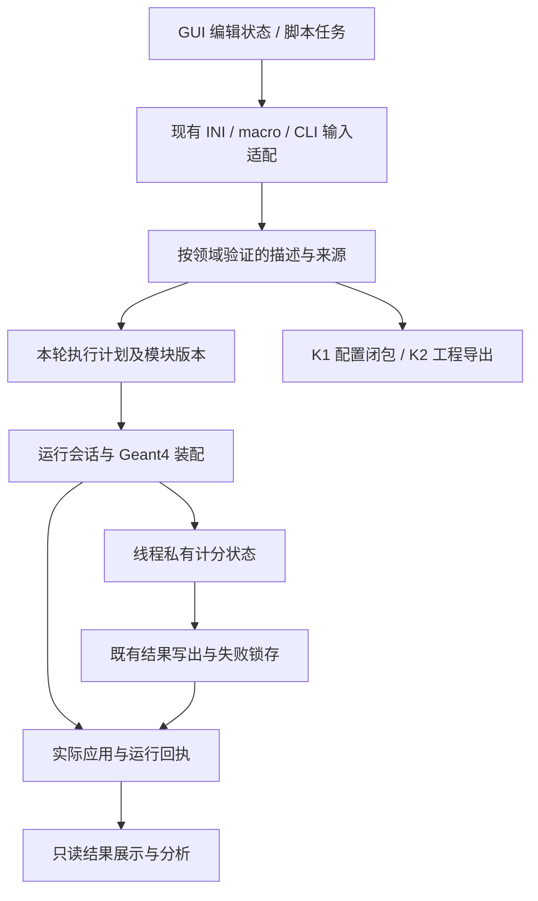

# G4UniversalSim 架构优化与渐进迁移规划

日期：2026-11-08。版本：规划 v1，供评审和后续实施立项。**本轮规划已形成，实施尚未启动；本文件不解除 K2 后停点、网页模型暂停或 F3 限制。**

## 1. 决策摘要

保留“C++ / Geant4 模拟内核 + Python / PySide6 桌面界面 + 配置驱动 + 独立工程导出”的技术路线。在现有程序内逐步明确数据所有权、模块接口和生命周期，不整体重写，不更换 GUI 框架，不转微服务，不引入动态插件平台。

这一轮的主要收益目标是：新增或修改组件时少触碰无关模块，失败不留下半更新状态，线程中的组件能可靠重建，旧项目与导出工程继续可用。**目前没有证据量化架构造成的开发时长损失，也没有可靠性能基线证明重构会加速输运。**维护成本改善与运行速度改善分开验收。

建议分成两个可独立交班的批次：

1. **第一批 AR0–AR2：建立迁移基线，完成几何事务切片与计分器构造边界。**优先解决静态审查中最具体、可验证的问题；完成后评价方案是否确实减少扩展影响。
2. **第二批 AR3–AR6：整理运行编排、GUI 状态、构建交付边界，完成整体回归。**复用第一批经验，仍按切片串行集成，每阶段结束都有可运行候选。

建议的主线为 `AR0 → AR1 → AR2 → AR3 → AR4 → AR5 → AR6`。构建影响检查从 AR0 起贯穿全程；AR5 才完成正式构建目标整理，不能等到最后才发现 K2 模板失效。用户批准实施后按阶段冻结清单；规划交付本身不视为实施批准。

## 2. 审查输入与当前基线

外部输入为用户提供的《G4UniversalSim 架构审查与技术路线评估.md》，原文件位于 `E:/Downloads/Chrome/`，SHA-256 为 `42d96b0039539ec2ec5137045655e8f3eae68f697e5e0a815e777ba4c64fe08a`。其静态审查基于默认分支快照 `83c0b1399584031f82d7d1fe38443ed2d1713e4f`，不是本机当前交付版本。文中建议作为审查输入，不作为执行指令。

本轮先读取 CURRENT，再核对 D 盘工作树和有限源码。本机 HEAD 为 `55ef3d623ea6a1ed6a70314c07a40d175ba1f603`，正式 K2 工程/测试候选为 `64bacb3e412ace7bf82fa9cf5969af679112c61b`，产品基线为 `b1a7ffbc0519a29cb37b458e2e1542640956976a`。三个身份不得混写为同一次构建。

|事项|当前事实|对本计划的影响|
|---|---|---|
|K2|固定范围带限制关闭；四云、12 原报告、734 用例、376754 断言及双平台安装已有验收记录|保留原交付基线；新结构必须继续支持 S-A / S-B 独立构建运行，不能把导出当作尚未开发的设想|
|H3|已关闭，已有平行世界计分、边界处理和限定科学对照|原审查“实现 H3 前先定语义”已过时，改为保护现有语义、受影响时复验|
|F3 / F7|F3 三批资源基线均不可判定，原 5% 门限与科学标准不变；F7 依赖保持|架构工作不另开性能批次，不宣称优化收益，不代替 F3 验收|
|配置与结果证据|已有 schema、EffectiveConfig、实际应用层级、来源哈希、run summary 和输出身份|复用并梳理所有权，不再建一套独立“真相模型”|
|几何能力|已有 SolidRegistry，能力与工厂共用记录；仍有通用参数及多处形状校验|改进已有描述/校验边界，不能把“无注册表”当作现状|
|GUI|已有独立 EditSession / WorkspaceSnapshot；窗口仍需从控件拼接状态，并维护兼容字段|迁移状态入口和适配关系，保留事务引擎、raw drafts 和恢复机制|
|K2 后停点|定时任务已 PAUSED，网页模型持续暂停|本轮只交付规划和证据索引，不派工、不恢复自动化、不开展产品测试或改造|

本轮发现与证据等级见[源码核对记录](collab/reviews/20261108-architecture-planning-evidence.md)。原验收记录见 [K2](verification/k2-final-20261107/README.md)、[H3](verification/h3-final-20261107/README.md)、[F3 R3](verification/f3-r3-baseline-20261107/README.md)。这些是既有证据，本轮没有重跑。

## 3. 问题优先级与处理决定

|优先级|问题及当前证据|本轮规划决定|不应得出的结论|
|---|---|---|---|
|P0：先验证|GeometryManager 在替换 root 后执行可抛异常的用户体积叠加，然后才发布文件/来源状态|AR1 先做真实调用反例；将候选树、用户覆盖及相关来源合为一次提交|尚未运行复现，不能称用户 GUI 数据已损坏|
|P1|RegisterScorer 接收对象；CloneForThread 重建默认 scorer，未复制已注册自定义对象；ScorerBase 无对应构造合同|AR2 用不可变描述与线程工厂构造内置和测试 scorer|不能称当前内置 scorer 失效，也不能把任意自定义 scorer 已支持作为旧承诺|
|P1|main / SimulationManager 同时承担入口、装配、配置、命令运行和收尾|AR3 逐步抽出配置解析协调、执行计划和会话收尾职责|拆文件本身不证明耦合降低|
|P1|GUI 快照仍读控件、表格和未提交单元格；flat 字段与 typed 模型兼容同步|AR4 将编辑数据所有权移入现有事务模型，控件变为输入和投影视图|不能删除无效草稿或旧格式来获得“单一状态”|
|P2|几何描述仍有 vector 参数与属性表，校验分散；已有注册表可复用|AR1 先迁移 box/tubs 的明确形状描述，余项走清晰兼容适配；继续统一共有规则|不一次改完所有形状，不静默改变长度、半长或角度语义|
|P2|CMake 全量收集 src，并在多个目标组织源码；K2 曾有快照缺文件和 CTest 根目录问题|各阶段检查导出闭包；AR5 明确 target 依赖和共同源码所有权|尚未测量编译成本，不预设加速百分比|
|独立路线|偏置、LET、DDD、NIEL 仍有科学适用域限制|保持原标签、反例和资料；以后按科学任务单独立项|不能用重构通过替代物理验证或删除原失败|

## 4. 目标架构与所有权

### 4.1 数据如何流动

这是逻辑职责图，不意味着另建每个方框对应的新框架或 Python 直接持有 Geant4 对象。GUI 继续通过现有后端进程入口运行；配置包、进程执行与独立工程导出继续分开。

|职责|复用基础|明确的所有权与依赖规则|
|---|---|---|
|输入适配|IniReader、ConfigManager、macro preflight、CLI overrides、GUI writer|保留原语法、别名和错误位置；只从本次实际读取的数据建立来源，不事后重读文件补造哈希|
|领域描述|VolumeNode、已有 source/physics/scoring 配置、SolidRegistry|描述为值数据；不可把 GUI 控件、输出 writer 或跨线程可变 Geant4 指针存入描述|
|执行计划|现有 Configure 流程和 EffectiveConfig|复用已有 requested/resolved/origin 与模块 generation；计划代表意图，不能自行将 evidence 升为 kernel/thread/run applied|
|运行会话|SimulationManager、Context、ActionInitialization、现有各 Manager|管理装配顺序、状态转换和失败收尾；不将旧业务公式搬进新的超级 Manager|
|线程组件|现有 CloneForThread、scorer、H2/H3 detector|共享仅限已证明不可变的数据；事件累计、writer、活动缓存明确归 worker 或 run 所有|
|输出和证据|OutputManager、HistoryStatistics、run summary、metadata|继续集中登记实际写出、锁存失败和完成状态；不增加第二套产物扫描或统计公式|
|编辑与展示|EditSession、WorkspaceSnapshot、ExperimentWorkflow、runner|编辑值和原始文本由模型持有；UI 只发编辑动作/显示投影；异步完成绑定 request/revision，不能覆盖新项目|
|交付与扩展|现有静态注册、schema 生成、K1/K2、runtime/SDK 打包|编译时扩展先行；保持限定导出能力，无动态载入任意库、脚本执行或远程插件市场|

### 4.2 关键设计约束

- **执行计划分时点形成。**输入预检、配置接受、内核构造、worker 应用、逐 run 完成是不同阶段。现有合法 PreInit macro 修改、多 run、受控 csh 入口必须继续工作；不能在读取 INI 后冻结整进程并拒绝原本支持的命令。第一版计划只覆盖已经迁移的模块，其他模块通过现有适配器运行。
- **配置只有一个权威接受路径。**新的值类型和 plan 是已有消费者接受状态的明确表示。禁止平行解析两套 INI，或为了 schema 统一让 Python 成为后端实际支持的判定者。复用既有生成器和能力数据；保留来源、单位和 raw 值。
- **计分输入按语义分型。**质量世界 hit、平行世界 scoring step、事件统计和输出记录不强行合并。真实材料/密度/分母质量、ghost 归属、步权重、零事件样本与 N 的定义继承 H2/H3 合同；不为抽象统一把 ghost step 写进普通 hits。
- **候选提交有原子边界。**先构造/验证候选，再一次提交有效模型及其来源。失败诊断允许更新，但旧有效状态、文件身份、revision/generation 和运行资格不能被半更新。若无法把某个内核动作回滚，必须在构造前拒绝，或保持原“新进程重建”边界。
- **兼容层有退出条件。**每个旧字段/适配器注明真实读写者、替代入口和移除条件；不永久双写两个权威状态。旧文件格式解码可长期保留；临时运行分支在相关消费者迁移并验证后移除。
- **不改变物理公式、随机调度、默认 physics list、输出单位和统计口径来换取结构整洁。**必须改变公开接口时另立兼容决策，不能夹带在文件移动里。

## 5. 阶段实施计划

下表为完整架构计划的交付地图。当前 AR0–AR6 均为“未开始”；本轮文档规划不算 AR0 实施完成。每阶段开始时把范围、候选、比较协议和停止条件写入独立清单，冻结后不持续扩项。

|阶段|交付物|依赖|完成判定|预计工程工作量*|
|---|---|---|---|---|
|AR0 基线与合同|迁移输入清单、依赖/消费者图、兼容表、比较规则、定向测试集|用户明确启动|覆盖所有拟改接口；代表性基线可复演；无悬空所有权决定|1–2 日|
|AR1 几何事务切片|候选构造与一次提交、box/tubs 规范描述、旧输入适配|AR0|失败不污染已接受状态；旧几何行为与诊断语义保留|2–4 日|
|AR2 计分线程构造|描述/工厂/worker 实例边界、内置迁移、测试扩展|AR1|无自定义实例静默丢失；多线程/多 run 隔离与 H2/H3 比较通过|3–5 日|
|AR3 运行编排|渐进执行计划、会话生命周期、统一失败收尾入口|AR2|CLI/INI/macro 优先级和实际证据保持；入口不再复制迁移后的领域规则|3–5 日|
|AR4 GUI 状态迁移|无控件依赖的编辑状态、窗口适配、旧项目转换|AR3|模型独立保存/恢复；GUI 编辑、Undo/Redo、陈旧任务拒绝保持|4–6 日|
|AR5 构建与导出边界|明确 CMake targets、能力/源码闭包一致、K2 新模板|AR4|相同源码所有权下原生/导出工程可构建测试；无仓库外隐式依赖|2–4 日|
|AR6 整体验收交班|正式矩阵、科学迁移比较、安装/导出与文档证据|AR5|按冻结标准整体签收；未过项及限制明列；提交可回退候选|2–3 日|

*仅为基于当前静态范围的粗略有效工程人日估算，总计 17–29 日；不等于自动化连续运行的日历承诺，也不以模型额度换算。第一批约 6–11 日。AR0/AR1 完成后按实际反例、修改面和验证耗时重估。已有环境能复用会减少等待，遇到结构性冲突须重新定界，不能为赶估算放宽验证。允许后续按文件所有权并行，但不预先承诺并行倍数。

### AR0：冻结迁移基线，不重复整套 K2 验收

**范围：**候选身份与已有测试/fixture 选择、真实读写者/调用图、依赖和兼容清单；仅补能约束迁移的缺失测试。冻结外部 INI/macro/CLI、项目快照、CSV/ROOT/JSON、metadata、有效配置和 K2 manifest 的行为合同。

**最低交付：**每个迁移接口有“生产者、消费者、线程、所有者、阶段、失败语义、旧格式、输出证据、回退点”；从现有用例中选定下面第 6 节的比较矩阵，保存输入/源码/二进制/环境身份。已充分验证且不受影响的基线按原 SHA 引用，只有缺少比较原始量时执行预先限定补测。

**工程边界：**记录主入口、SimulationManager、GeometryManager、ScoringManager、MainWindow mixin、打包脚本实际依赖；文件行数只用作导航，不作为架构分数。先记录现有改变一个 scorer/编辑字段/构建成员需要碰哪些责任模块，AR6 做同口径对照。

**停止条件：**所需科学标准或接口兼容决策未定义，不开始相应改造；不扩大成全仓库代码美化或通用测试平台。

### AR1：首个可验证切片——几何加载原子性

**文件范围：**优先 `include/Geometry/GeometryManager.hh`、`src/Geometry/GeometryManager.cc` 及几何组件测试；typed 形状切片再限于 `VolumeNode`、`GeometryConfig`、`SolidRegistry`/对应 builder 和既有几何测试。若需要更多生产文件，先说明调用依赖，不能一次迁移全部几何系统。

1. 构造旧有效树 A 并保留用户附加体积；尝试载入树 B，使附加体积出现重复名、找不到 parent 或在第二个附加节点失败。通过实际接口观察失败前后，而非只搜索源码字符串。
2. 若风险复现，改为构造候选模板树/最终树/用户体积集合/来源证据，全部校验后提交；若现有调用保护使某路径不可达，记录该事实，保留真实可达的合同测试，不编造事故。
3. 同时检查文件路径、inputFiles、effective reader、接受 revision/generation、dirty 状态；失败诊断与最后成功配置分开。不要只保护 root 指针。
4. 在第二个小提交中仅将现有 box/tubs 的参数语义明确化，复用 SolidRegistry 条目与工厂；其余形状保留有名兼容入口，未知/非法输入仍按旧合同拒绝。

**验收：**反例先失败后通过或证明不可达；异常路径无部分树/来源污染；原成功路径、aliases、单位和布尔工具语义保持；未创建 Geant4 对象的早期失败边界保持。触及实际构造时执行已有几何 backend 回归、H3 相关边界与 K2 S-A/S-B 必要比较。

**回退：**按切片提交撤回适配器/生产改动，保留反例和失败记录；不在用户项目上原地改写格式。接受后才扩大形状覆盖，剩余类型不得成为第一切片收尾的无限前置。

### AR2：计分器配置与 worker 构造合同

**文件范围：**`ScorerBase`、`ScoringManager`、内置 scorer 的配置适配与相关 Action/SD 消费点，`HistoryStatistics`/OutputManager 原算法原则上不改。H3 detector 仅在真实接线需要时改，不能顺带重写导航归属算法。

目标逻辑为 `ScorerSpec → 已登记工厂 → 每线程独立实例 → 每run/event状态 → 既有输出通道`。具体类名在 AR0 后冻结，不把示意命名当现成 API。

- 用已有字段形成不可变配置描述，显式包含 type/id、enabled、过滤/谱、输出能力以及所需材料/体积信息的引用身份。大表可以共享经证明不可变的数据，不共享累计器和 writer。
- 每个实际 worker 经相同工厂重建实例，不克隆上一次 run 的累计值，不捕获短生命周期对象。线程初始化、异常、销毁和 Begin/EndRun 均有真实收据。
- 现有 `RegisterScorer(unique_ptr)` 的真实消费者先列清楚：若无法提供 MT 重建合同，明确拒绝对应多线程用法或提供迁移适配，不能静默漏掉；不直接增加强制纯虚方法破坏所有旧实现。
- 将内置能力判断逐步归到描述/适配器，但保留 LET 比值、Dose 质量、Fluence 长度、DDD/NIEL 各自约束；“移除 dynamic_cast 数量”不是目标。
- 只增加一个**测试用途**的确定性计数 scorer，验证扩展链路；它不是新科研功能，不进入面向用户的物理能力声明。其数据是计数事件/固定输入，不能借它证明剂量物理正确性。

**验收：**注册空值/重复 id/未知 type 负控；1/2/4 worker 和连续两个 run 下实例隔离、无丢失/串值、事件集合正确，工厂失败显式失败且输出/摘要不报成功；内置 Edep/Dose/Fluence/LET/DDD 的已有数值回归保留。H2 过滤/谱及 H3 ghost/mass 输入、分母质量、边界归属、空 hits 输出均按原合同验证。迁移后测试扩展不要求修改主入口或中央内置类型分支；新增接线应收敛到实现、登记和测试文件。

**第一批复盘：**只有 AR1/AR2 合同通过且修改影响确实收敛才进入 AR3。若新抽象反而要求更多无关修改，缩减接口而不是推广它。

### AR3：运行编排与执行计划

**文件范围：**`main.cc`、`SimulationManager` 与必要 Core/Config 消费点，分“配置协调”“运行会话”“摘要收尾”提交，避免同一提交同时改输入规则与线程调度。

主入口保留 CLI 解析/入口选择/退出码映射；SimulationManager 保留兼容外观，逐步委托配置协调和生命周期组件。第一版计划表示已接受配置及资源/能力身份，不复制所有 Manager 可变状态。仍需粒子表或真实几何的验证留到原合法阶段，计划不能提前宣称它们已通过。

**验收：**默认值 < 主 INI < 合法 macro < 显式 CLI 的现行合同不变；dry-run、batch、csh、正常完成、取消、失败、多 run 各自摘要/退出码保持；仅完成事件数正确并有可信输出才报告成功。未知/非法命令、输出写失败、初始化/worker/收尾失败保留原首因。实际来源与应用证据分别验证；不得新增“初始化后任意换几何”能力。

**停止条件：**发现必须变更随机数派发或物理装配次序才能继续时，先拆分为独立行为变更决策，不让它混入结构迁移。

### AR4：GUI 从控件持有状态转为模型持有状态

**文件范围：**`core/project.py`、`edit_snapshot.py`、`edit_state.py`、`edit_transactions.py`、相关 editor model，及 `window/transactions.py`、project/run/content 等实际适配入口。复用 ExperimentWorkflow/runner，不重建第二个任务调度器。

先迁移 run/path 字段，再迁移 source/physics/scoring，最后迁移 material/geometry 表格；每组独立提交并跑对应验收。窗口 mixin 可以暂时保留，但不能继续新增领域状态所有权。按职责抽 controller/service，避免仅把同一个 self 拆到更多文件。

**状态分四类：**已解析领域数据、未通过校验的原始草稿、编辑交互状态、运行证据。前三类进入现有可序列化快照；运行证据按现有 revision/request 绑定历史，不随 Undo 恢复为“当前已通过”。源文本与 hash 来自实际读取记录，旧项目 `None` 与显式空文档仍不同。

**验收：**不用创建 QWidget 也能编辑、序列化和恢复已迁移的数据；真实窗口中半输入数值、未提交表格单元格、错误路径、材料文件外部变化、保存/重载/Undo/Redo/崩溃恢复无损。运行中编辑限制、取消、换项目后迟到结果拒绝、已生成命令预览与原始路径草稿关系不变。既有 K1/L1 动作必须走同一个事务入口。

几何父子树、COMSOL 式导航和悬停说明保留为后续交互需求；本阶段仅建立能支撑这些功能的模型接口，不同时改版界面，以免混淆状态回归与视觉变化。窗口焦点/选择等展示状态仍可以从控件读取，不把“零控件读取”作为不合理目标。

### AR5：构建、能力声明与交付闭包

**文件范围：**`CMakeLists.txt`、必要 `cmake/`、现有 schema/能力生成入口、`packaging/export_template.py`、交付快照脚本及其测试。全仓目录搬迁、依赖版本升级和安装器改版不在范围。

- 按实际依赖分 target：可独立测试的值/统计/配置部分、Geant4 适配部分、应用装配/入口。只在有独立消费者和测试时拆库，不为了层数创建空包。
- 明确同一生产源的归属，生产程序与组件测试共享适合的 target；保留 source/header/build-input 指纹，头文件变化必须重建相关目标，不能复用指向旧树的 CMake cache。
- SolidRegistry、已有 schema 和支持矩阵的事实互校，不另造通用元模型。构建目标导出需要的文件仍由 K2 既有模板机制完整登记。
- 新增/移动生产源码后重新生成新模板身份，旧 `b228...` 保留；逐项检查 CMakePresets、fixture/NIEL 数据、相对路径、CTest source root。新的模板数目可以变化，但必须由真实闭包解释，不能固定凑 309。

**验收：**Windows / Linux 干净构建；现有 Linux Geant4 11.3.2 / 11.4.3 范围保留；新导出在仓库外构建并运行 S-A200/S-B1000、两个组件测试、既有拒绝路径及单行 C++ 修改后重建。两个平台分别核对依赖与产物；不得从一个平台复制原生包到另一个。验证安装后的实际导出入口，补上历史未直接观察的操作证据；若不可执行，明确留未通过项并由主审按新冻结标准处理，不以旧组合证据自动替代新要求。

### AR6：整体验收与交班

冻结最终源码/测试/模板候选，完成受影响定向验证及原正式 profiles、严格证据检查和真实云工作流。目标不是保留原断言总数；允许因有效测试重组改变数量，但每个旧合同/负控必须映射到等效证据，不能删掉失败用例来通过。

Windows/Linux 同一应用版本分别构建、安装、运行、卸载和命名；版本号由 AR0 兼容决策冻结，不通过文档改号冒充新包。保存真实包及 SHA、依赖/许可证、安装和独立导出结果，明确哪里只是 CI 日志、哪里有可分发产物。

完成技术文档、公开支持事实、旧项目兼容说明、组件扩展指南、风险与回滚说明。提供一条真实的“修改现有组件 → 测试 → 导出工程继续开发”开发者路径。若未来 SiP/单粒子效应案例需要新的电荷收集/SEU 模型，记录需求缺口，不能为了演示临时塞入未验证算法。

**整体关闭条件：**第 6、7 节所有约定必要条件满足；核心行为/科学等价/数据保护问题不能按普通限制签收。最终给用户架构改造报告与是否恢复功能开发的建议；即使架构验收通过，也不自动进入 L2/F7/H8。

## 6. 验证矩阵：保护成果，不无限增加测试

|边界|优先复用的真实入口/测试|新增或需要明确的迁移证据|
|---|---|---|
|几何加载与构造|`test_geometry_config_diagnostics.py`、`test_geometry_safety_contract.py`、`test_q1_geometry_boundaries.py`、几何 roundtrip backend|事务半失败反例、前后状态/来源/资格比较、box/tubs 兼容输入|
|计分与统计|`test_scoring_numeric.py`、dose/fluence/let、`test_h2_volume_scoring.py`、`test_parallel_world.py` 与两个 C++ component|实际 factory 路径、1/2/4 worker、两个 run、零事件、失败锁存、质量/ghost 数据隔离|
|来源与生命周期|`test_effective_lifecycle.py`、各 effective module、`test_run_summary.py`、`test_interactive_commands.py`|迁移计划与真实应用不混写，非法时点修改、部分运行失败和输出错误继续可辨|
|GUI/项目|F5 transactions/recovery/source snapshots、K1 workflow/history、现有 GUI smoke|无控件的状态测试 + 实窗旧项目编辑/恢复；无效草稿和迟到结果拒绝|
|导出交付|`test_k2_project_export.py`、模板 check、原生 CMake/CTest、runtime/SDK 安装|新闭包、仓库外两场景、两组件、单行 C++ 重建、实际安装版导出操作|
|科学等价|已有 Q2/H2/H3 已签范围和旧失败|只复验受影响科学量；复用输入定义和原判据；旧失败/限制原样保留|

### 6.1 比较规则

1. **确定性行为：**同平台、同编译配置、同 Geant4/数据/种子/线程模式的前后候选，配置接受/拒绝、事件集合、字段语义与可重复输出应一致。输出含时间、路径、commit 等自然变化项时，比较协议提前列白名单；这些字段仍须检查与新产物真实一致，不能简单全删。CSV/ROOT/JSON 各用相应语义比较，不能要求所有 ROOT 文件逐字节相等。
2. **数值与随机性：**纯搬移代码且保持算术/随机调用顺序时，优先要求可确定部分逐项相同；多线程归并/跨平台不预设 bitwise 相同。浮点容差和统计等价区间必须在看新结果前按原合同冻结，不得用“存在浮点误差”解释任意差异。迁移尽量不改归并顺序。
3. **H3 科学对照：**涉及实际计分/步/线程语义时按原薄层剂量与无扰动对照协议执行一个事先限定的比较任务。现有 H3 报告记录 B 相对区间边界 ±1%、C ±0.5%，对应原 99% 区间和限定病例；具体输入、N、种子与方法仍以原合同为准，不移植为其它物理量的万能容差。不因修改仅为文档重跑物理基准。
4. **失败路径：**非法输入、线程初始化失败、写出失败、恢复失败和未知事实必须保持拒绝/failed/unknown，不能因整理错误层级而成为 success。旧失败数据不可覆盖。
5. **资源：**架构验收可检查明显无界增长、线程泄漏和已有资源安全断言；不以这种检查代替 F3 的时间/内存性能结论，不新增 F3 批次或偷偷改变其标签。需要正式性能测量时另行获得用户对方案/批次的明确授权。

### 6.2 限制验证成本

每个切片先跑最小反例及直接受影响消费者；通过并冻结后才运行对应正式层。仅当跨模块/构建/交付内容改变时扩大矩阵。纯文档变更做文档与闭包检查，不重建所有二进制。主审按输入/源码/测试/产物身份复用未受影响报告，而非每次机械重跑四云。

两次有证据的同类环境阻断后改变观察方法或记录限制，不为通过而循环增加批次。测试/收据脚本只改到足以验证当前接口，不把架构项目变成验收平台重构。能用现有组件测试观察的行为不额外造通用 mock 框架；不能只用 AST/字符串断言代替真实调用。

## 7. 如何判断“架构确实改善了”

|目标|验收方法|成功条件|
|---|---|---|
|失败原子性|真实失败前后观测有效模型及来源|AR1 所列反例无半更新；错误诊断仍准确|
|扩展影响可控|用同一测试 scorer 对照迁移前后的修改责任模块|新扩展不改 main、会话编排或中央内置分支；工厂和实现拥有清晰范围|
|状态唯一|搜索并跟踪已迁移字段的实际写入口，模型独立测试与实窗操作互证|一个权威数据拥有者，旧字段仅兼容投影；保存不依赖重新读取控件重建领域数据|
|模块可测试|直接构造领域描述/事务/统计组件，验证依赖图|已拆纯逻辑可不启动 GUI/完整输运测试；没有新增反向 UI 依赖|
|发布边界稳定|仓库外导出构建、安装后实际导出与使用|没有隐式依赖开发树；包内容与实际构建输入可追溯|
|科学和行为保持|第 6 节迁移对照及原正式门禁|约定行为保持、原失败不被抹除、适用域不被扩大|
|维护成本可观察|记录代表性变更触及模块、重复规则位置、必要验证任务与返工原因|报告前后事实；不预设不可信的“开发速度提升 X%”指标|

“主文件变短”“类变多”“测试断言更多”都不能独立证明成功。若一个抽象没有两个实际消费者或没有减少明确的所有权歧义，优先保持简单函数/值结构，不强行发展框架。

## 8. 兼容、迁移与回滚

- 外部 INI/macro/CLI 和现有项目格式默认不变。内部 typed 数据由适配器形成；如确须改持久化 schema，单独增加版本和旧格式读取测试，迁移产生新副本，不覆盖用户原文件。
- 旧读写/新读写不能永久并行。每组字段先建立契约测试，再切换一个生产消费者，比较通过后删除对应临时路径。禁止在生产中双运行模拟来比较两条路径，以免额外消耗随机数或重复写输出。
- 每个切片提交都应可构建、可回退；回退生产提交时保留测试结果、旧输入和失败日志。已写入用户数据的变化须先有旧版本读取或备份恢复方案。
- D 盘已有五项 tracked dirty 和未提交 H8/F3 讨论保留。开始实施时选定干净基线或经明确归属确认的差异，C 盘仍用于独审。不要把旧 dirty 作为本次优化的一部分提交，也不要全仓格式化。
- 作者只写约定生产/测试范围及 author 回执；主审独立证据目录不可覆盖。回执采用唯一候选/批次路径；中间失败不得复用固定文件名覆盖。

## 9. 与后续技术路线的关系

|方向|架构优化提供什么|仍需单独完成什么|
|---|---|---|
|L2 代码 Agent|稳定任务/编辑/导出边界和明确错误接口|代码执行隔离、授权、恢复及有限修复验收；不能由本计划自动启用|
|F3 → F7|更可定位的组件责任和可复现任务身份|F3 噪声/资源约束未解决；二维并发扫描仍受原依赖约束|
|H4/H5/H6/H8 等物理/几何扩展|可验证的类型描述、worker 构造与能力声明|每项物理模型、数据、适用域和独立验证；不夹带规则体素/DICOM 实现|
|SiP / 单粒子效应研究|用现有材料、几何、粒子源和计分能力表达已有问题，识别扩展接口|电荷收集/SEU 等未实现响应须独立建模；不以配置可表达或同源对照称独立物理验证|
|脚本编排|保持现有 CLI/配置与结果接口，供批处理使用|不新增 Python 直连内核绑定或通用脚本执行环境，确有用户需求后评估|
|切换 GATE / OpenTOPAS / GRAS|保留为今后需求与迁移成本比较对象|本轮不选择新底座，也未复核这些框架的最新版本/许可证/分发条件|

外部报告建议“不要暂停所有功能”，本项目当前按用户更晚的明确决定暂停新增功能。因此先完成独立架构整治批次再决定恢复路线；不能用报告的建议覆盖用户停点。

## 10. 启动方式与接续

本次可直接用于后续立项，无需重新从全仓阅读开始。建议下一次明确授权先覆盖**第一批 AR0–AR2**，验收和复盘后再决定第二批；如用户明确授权整套计划，则按阶段清单连续推进，仍保留各验收门。

启动后第一个实际任务为 AR0 的兼容/比较合同；第一项生产改动只能在对应合同冻结后进入 AR1。主审负责边界、独立复验和阶段签收，DeepSeek 负责限定实现与自测，复用原协作绑定前先核状态，不因旧游标重新派工。网页模型继续暂停。现有定时任务保持 PAUSED，恢复它需要用户新的明确指示。

每阶段结束更新 CURRENT 与验收记录，完成整体架构验收时再同步 ROADMAP / STATUS / 支持矩阵及开发指南。**本次不修改 ROADMAP 的旧阶段状态，不将 AR 编号混入已关闭的 K2 清单，不开启任何实现任务。**
